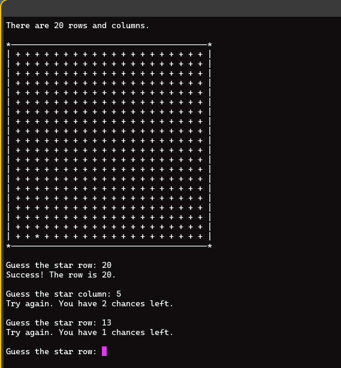
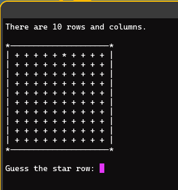

<div align="center">

# CLI-Guessing-Game - Try to Guess the Random Star


*A command-line, interface-based 'guessing' game built with [Python](https://www.python.org/).*

## Gameplay Example




</div>

## Features

1. The `os` and `sys` modules are used to give the player an improved experience by clearing all previous actions from the screen and allowing a smooth exit midway through the game.

## The Stack

| Category | Details |
| --- | --- |
| Language | Python 3 |
| Standard Library | `os`, `sys` |
| Interface | Terminal / command-line (Unix-like) |
| Tooling | Git, any Python-capable IDE (e.g. VSCodium) |
| License | MIT |

## Project Structure

```text
├── guessing_game.py       # Entry point; imports all necessary modules
├── images/
│   ├── image_01.png         # Gameplay example 1
│   └── image_02.png         # Gameplay example 2
└── LICENSE
```

## Prerequisites

1. This application can only be run if you have Python installed or run it through the IDE of your choice.

2. Everything is intended to be run on a Unix or Unix-like system but more concrete Windows support is coming.  Everything will work if you are on MacOS, Linux, the BSD of your choice, or running through Windows Subsystem for Linux.

### Applications and Software

- **Python** - Download from [python.org](https://www.python.org/) or via your OS package manager.
- **Integrated Development Environment** - A good example would be [VSCodium](https://vscodium.com/), but anything will do as long as it can run Python programs.

## Installation

Clone this repository using the **Clone** button above, or download the source archive, then place the files in a directory of your choice.

### For use of the terminal

```bash
mkdir ~/Code/guessing_game/

# Clone or extract this repository into ~/Code/escape/
```

**Notes:**

The repository can be downloaded manually and be placed in any directory of your choice as long as all of the files remain together.

## Start and Play the Game

### Start the Game

```bash
cd ~/Code/guessing_game/

python3 guessing_game.py
```

### Play the Game

1. Enter a number to choose the location of a row or column.

2. Entering anything other than an integer, 'exit', or y to begin the game will fail.

## What I Learned

- **Standard library fluency:** used `os` and `sys` to clear the terminal and
  handle clean mid-game exits without external dependencies.
- **Cross-platform awareness:** targeting Unix-like systems (Linux, macOS, BSD,
  WSL) and planning concrete Windows support.
- **Documentation and version control:** wrote user-facing install/play
  instructions and tracked the project with Git.

## License

This project is licensed under the MIT License — see the [LICENSE](LICENSE) file for details.

Copyright (c) 2026 Benjamin (Ben) LaShell
